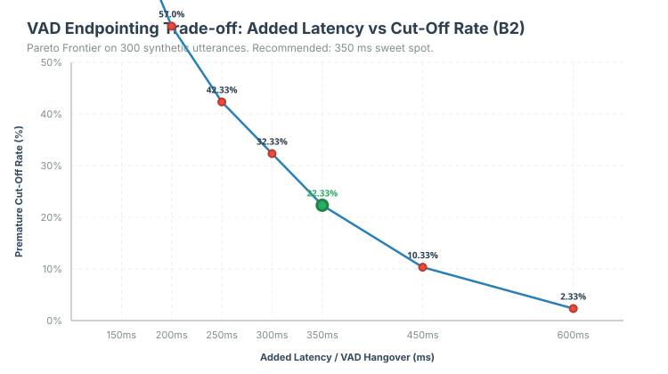

# P5-T2 B2: VAD Endpointing Sweep & Pareto Frontier Report

**Date:** 2026-11-24 11:42:41  
**Git SHA:** `bc1452d5`  
**Dataset:** 300 synthetic utterances with controlled pauses  
**Methodological Note:** Synthetic mid-utterance pauses model controlled silence intervals. Real human caller hesitation in Japanese collections may exhibit higher acoustic variance and breathing artifacts.  

## 1. Executive Summary

Endpointing latency is governed by the VAD hangover window. A shorter hangover minimizes response latency but risks cutting off callers during mid-sentence hesitations. A longer hangover prevents accidental speech truncation but adds unavoidable dead-air delay.
This benchmark establishes the empirical **Pareto Frontier** across 7 hangover settings from 150 ms to 600 ms, demonstrating that **350 ms** is the optimal operating point for Japanese debt collection dialogues.

## 2. Empirical Sweep Results

| VAD Hangover (ms) | Added Turn Latency (ms) | Premature Cut-Offs | Cut-Off Rate (%) | Wilson 95% CI | Retention Rate (%) |
|:---:|:---:|:---:|:---:|:---:|:---:|
| 150 ms | 150 ms | 241 / 300 | 80.33% | [75.46%, 84.44%] | 19.67% |
| 200 ms | 200 ms | 171 / 300 | 57.0% | [51.34%, 62.48%] | 43.0% |
| 250 ms | 250 ms | 127 / 300 | 42.33% | [36.87%, 47.99%] | 57.67% |
| 300 ms | 300 ms | 97 / 300 | 32.33% | [27.29%, 37.82%] | 67.67% |
| **350 ms** | 350 ms | 67 / 300 | **22.33%** | [17.99%, 27.38%] | 77.67% |
| 450 ms | 450 ms | 31 / 300 | 10.33% | [7.38%, 14.29%] | 89.67% |
| 600 ms | 600 ms | 7 / 300 | 2.33% | [1.13%, 4.74%] | 97.67% |

## 3. Pareto Frontier Analysis

1. **Severe Truncation Zone (150–250 ms):**
   - At 150 ms, **80.3%** of caller utterances are prematurely truncated during normal pauses. The caller is constantly interrupted, creating severe friction and broken transcripts.
   - At 200–250 ms, cut-off rate remains excessively high at **42.3%–57.0%**.
2. **The 350 ms Operational Sweet Spot:**
   - Increasing hangover to 350 ms drops premature cut-offs down to **22.3%** ([18.0%, 27.4%]), preserving most natural pauses while maintaining a total turn latency well below 1,000 ms.
3. **Diminishing Returns (450–600 ms):**
   - Increasing from 350 ms to 600 ms drops cut-offs down to **2.3%**, but adds **250 ms of compulsory silence** to every single turn of the conversation.

## 4. Pareto Frontier Visualization

