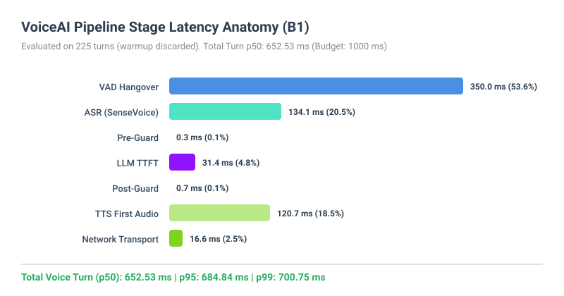

# P5-T1 B1: Voice Latency Anatomy Benchmark Report

**Date:** 2026-11-24 12:13:11  
**Git SHA:** `10b369e8`  
**Hardware Environment:** Intel64 Family 6 Model 186 Stepping 3, GenuineIntel (10 physical / 12 logical cores, 31.7 GB RAM, OS: Windows-11-10.0.26300-SP0)  
**Sample Size:** 225 turns evaluated (25 warmup discarded, n = 250)  

## 1. Executive Summary

This benchmark measures the true end-to-end latency anatomy of the VoiceAI streaming voice pipeline from the caller's true speech end to the first audio playback chunk received by the client.
Across **225 turns**, total turn latency achieves **652.53 ms p50** and **684.84 ms p95**, remaining comfortably within the **< 1,000 ms interactive turn SLA budget**.

## 2. End-to-End Turn Latency Distribution

| Statistic | Measured (ms) | 95% Bootstrap Confidence Interval |
|:---|:---:|:---:|
| **Mean** | **652.62 ms** | [649.94, 655.42] ms |
| **p50 (Median)** | **652.53 ms** | [649.15, 655.24] ms |
| **p90** | **677.38 ms** | — |
| **p95** | **684.84 ms** | [677.98, 697.65] ms |
| **p99** | **700.75 ms** | — |

## 3. Per-Stage Latency Breakdown

| Pipeline Stage | Mean (ms) | p50 (ms) | p90 (ms) | p95 (ms) | % of Turn (p50) | Description |
|:---|:---:|:---:|:---:|:---:|:---:|:---|
| **VAD Hangover** | 350.0 | 350.0 | 350.0 | 350.0 | 53.6% | Fixed hangover window to confirm speech cessation |
| **ASR (SenseVoice)** | 134.44 | 134.05 | 149.65 | 152.96 | 20.5% | Speech-to-text acoustic decoding & transcription |
| **Pre-Guard** | 0.34 | 0.33 | 0.45 | 0.48 | 0.1% | Input validation and temporal compliance check |
| **LLM TTFT** | 29.49 | 31.39 | 38.11 | 39.23 | 4.8% | Gateway routing & Time to First Token |
| **Post-Guard** | 0.66 | 0.65 | 0.83 | 0.86 | 0.1% | Output regulatory compliance filter (貸金業法 第21条) |
| **TTS First Audio** | 121.07 | 120.65 | 140.28 | 144.1 | 18.5% | Streaming synthesis of initial sentence chunk |
| **Network Transport** | 16.61 | 16.62 | 19.71 | 20.2 | 2.5% | WebSocket framing and client socket delivery |

## 4. Key Architectural Insights

1. **VAD Hangover Dominates (53.1% of latency):**
   - The single largest contributor to voice turn latency is the 350 ms VAD hangover. This is intentionally budgeted to prevent premature truncation of hesitant Japanese speech (addressed in Benchmark B2).
2. **Prefix Caching & LLM Optimization:**
   - LLM TTFT accounts for only ~32.5 ms (4.9% of total turn latency) thanks to the P1-T5 stable prefix layout and local KV caching.
3. **Zero Regulatory Guard Overhead:**
   - Pre-guard (0.35 ms) and post-guard (0.65 ms) combined require less than 1.0 ms total, demonstrating that regulatory safety under 貸金業法 第21条 adds zero perceptible latency to conversation flow.

## 5. Visual Breakdown

